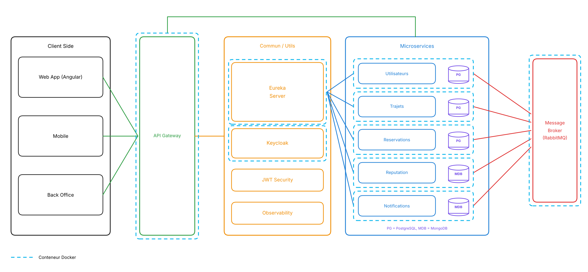

# CampusRide 🚗

**Plateforme de covoiturage universitaire** : conception et développement basés sur une architecture microservices.

> Module AWD · Classe 4DASI15 · Groupe **Les Intelos** · Année universitaire 2026–2027
> Encadrant : Mr. Sallemi Oussema

## Idée du projet

Les étudiants se rendent chaque jour sur le campus depuis des quartiers ou des villes mal desservis, alors que de nombreuses voitures roulent avec des places vides. CampusRide met en relation des **étudiants conducteurs** et des **étudiants passagers**, avec un accès réservé aux universitaires (e-mail vérifié) et un système de confiance (avis, score, signalements, sanctions).

**Fonctionnalités principales :** comptes vérifiés · publication et recherche de trajets · réservation et paiement · réputation · modération · notifications et chat.

## Architecture globale



- **Clients** : application web Angular, mobile et Back Office, tous via l'**API Gateway**.
- **Keycloak** émet et valide les JWT ; **Eureka** permet la découverte des services.
- **Chaque microservice** possède sa propre base de données et communique par REST (OpenFeign) ou par événements (**RabbitMQ**).
- **Chaque composant** s'exécute dans son propre conteneur **Docker**.

## Microservices

| Microservice | Port | Base de données | Responsable |
|---|---|---|---|
| Utilisateurs et Auth (`user-auth-service`) | 8081 | PostgreSQL | NourEl Houda Nasfi |
| Trajets (`trip-service`) | 8082 | PostgreSQL | Sahar Raach |
| Réservations et Paiements (`booking-service`) | 8083 | PostgreSQL | Tasnime Kaabachi |
| Réputation et Modération (`reputation-service`) | 8084 | MongoDB | Aziz Mokni |
| Notifications et Messagerie (`notification-service`) | 8085 | MongoDB | Imen Hammami |

Socle commun (développé par toute l'équipe) : `api-gateway` (8080), `discovery-server` (Eureka, 8761), Keycloak (8180), RabbitMQ.

## Technologies

Spring Boot · Spring Cloud OpenFeign · Resilience4j · OpenAPI / Swagger · PostgreSQL · MongoDB · RabbitMQ · Keycloak (JWT) · Docker / Docker Compose · Angular · Clean Architecture.

## Structure du dépôt

```text
CampusRide-4DAS_I15-Intelos/
├── Backend/            # microservices et socle commun
├── Frontend/           # application Angular
├── documentation/
│   ├── presentation/   # présentation de la séance 4
│   └── diagrams/       # diagrammes (architecture globale, classes, interactions…)
├── docker-compose.yml
└── README.md
```

## Organisation du travail

- `main` : version stable · `develop` : intégration des services.
- Une branche par fonctionnalité (ex. `feature/booking-page`), fusion dans `develop` par pull request relue par un autre membre.
- Suivi des tâches avec **GitHub Projects** (À faire, En cours, En revue, Terminé).

## Équipe

| Membre | Rôle |
|---|---|
| Tasnime Kaabachi | Réservations et Paiements |
| Imen Hammami | Notifications et Messagerie |
| Aziz Mokni | Réputation et Modération |
| NourEl Houda Nasfi | Utilisateurs et Auth |
| Sahar Raach | Trajets |

